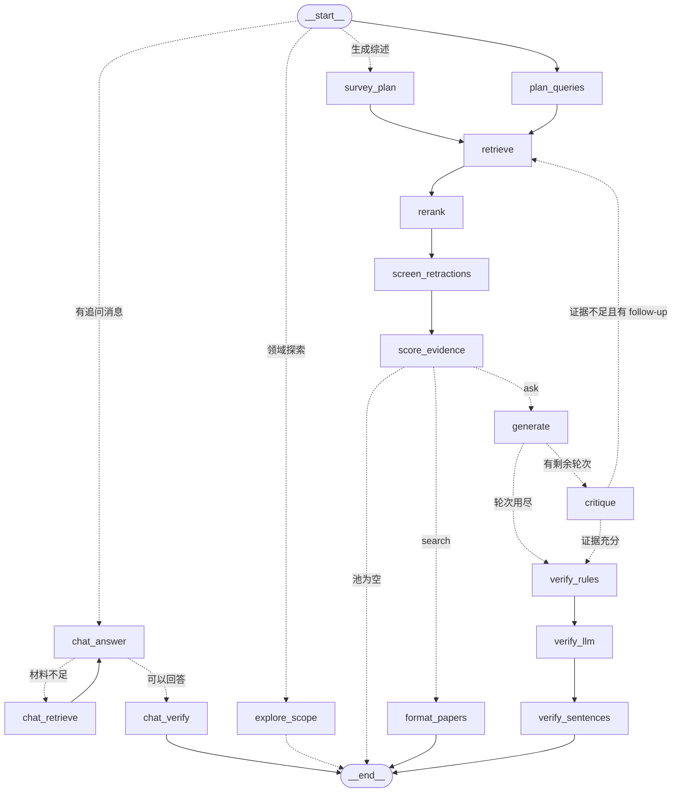

# ScholarMate 📚

一款 OpenScholar 风格的文献智能体：输入研究问题 → 多源检索论文 → LLM 生成带引用的回答 → 三层证据校验（规则 + DeepSeek 归因 + 逐句全文证据）→ 不足则迭代检索。编排层基于 **LangGraph**，检索/校验原语全部为纯 Python 标准库。

支持 **🤖 智能问答**、**📄 仅搜索论文** 与 **🔭 领域探索** 三种模式：读完回答还能**继续追问**（交互对话，不重新检索），以及排序、过滤、**筛选留痕（纳入/排除/待定 + 理由）**、文献导出、批量下载 PDF、运行快照与历史记录。

## 功能一览

| 环节 | 功能 | 说明 | 实现 |
|---|---|---|---|
| 模式 | 🤖 智能问答 | 检索 → 生成带 `[n]` 引用的综述 → 三层校验 → 证据不足自动迭代补检（`MAX_ROUNDS=3`） | `graph.py` |
| | 📄 仅搜索论文 | 只出论文列表，不做校验、**不截断数量**（ask 模式保留相关性 top 20） | `graph.py` |
| | ⚡ 快速模式 | 关掉逐句全文校验，跳过声明拆分/取证/判决（实测 174s → 34s 量级） | `sentences.py` / `web.py` |
| | 🧭 查询规划 | DeepSeek 把问题拆成 2-3 条英文检索词，失败退回原问题 | `graph.py` / `llm.py` |
| 检索 | 6 源并行 | Semantic Scholar + OpenAlex + Google Scholar(SerpAPI) + arXiv + PubMed/Europe PMC + Crossref | `search.py` |
| | 数据源注册表 | 新增数据库只需写 `search_foo(query, limit)` 并 `register_source()`，自动进入并行合并、独立限速与统计 | `search.py` |
| | 经典锚点检索（②b） | 首轮前 2 条检索词按被引量排序，捞回 ≥100 引的奠基工作（实测 ≥100 引论文 5 → 22 篇） | `search.py` |
| | 失败熔断 | 失败源跳过 `SOURCE_COOLDOWN_S`（默认 180s）、尊重 `Retry-After`，单源被限流不拖垮整轮 | `search.py` |
| | 过滤 | 年份窗口（近 1/3/5 年）、仅综述（Survey/Review）、限定期刊/会议（venue 子串） | `search.py` |
| | 刊物层级筛选 | 🏷 正刊 / 子刊 / 一区–四区 六个勾选框（可多选，OR 关系），只输出勾选层级的内容；层级**先查本地表**（`outputs/journal_tiers.json`，可放官方分区表）→ 内置规则（Nature/Science/Cell/Lancet/NEJM/JAMA/BMJ/PNAS 主刊与系列刊）→ 未收录刊按 OpenAlex 2 年平均被引**估算**（界面标注「估算」，**不是官方分区**）；会议/预印本/查不到层级的默认滤除，可用「保留会议/预印本/未分类」开关留下；结果条显示保留 X/Y 篇、滤除多少、其中多少篇查不到层级 | `journal.py` / `search.py` |
| | 排序 | 相关性（LLM 重排）/ 时间近→远 / 远→近 / 被引高→低 / 低→高 / 标题 A→Z；切换排序**本地即时重排**，不重新检索 | `graph.py` / `web.py` |
| 可信度 | 撤稿筛查 | OpenAlex 批量 50 DOI + Crossref 逐 DOI / 标题反查 + 标题启发式；无 DOI 也能查，磁盘缓存 30 天 | `retraction.py` |
| | 三层校验 | ① 规则层（`[n]` 映射、标题匹配、引用撤稿论文告警）→ ② LLM 归因层 → ③ 逐句全文证据层 | `verify.py` / `sentences.py` |
| | 逐句证据可复查 | 正文内联 `📎 原文证据(n)` 原位展开，标注「全文 / 摘要」与原文直链 | `sentences.py` / `fulltext.py` |
| | 证据强度徽标 | 多篇交叉支持 / 全文支持 / 仅摘要支持 / 支持（未取到原文）/ 不支持 | `sentences.py` |
| | 引用编号坐标系 | 逐句校验一律用**回答自身编号**；补充检索的新论文标 `in_answer=False`，绝不顶替正文 `[n]` | `sentences.py` |
| 证据评分<br>（**仅智能问答**） | 10 维度加权评分 | 相关性/直接性/方法可靠性/重复验证/结构支持/数据完整性/物种匹配/影响力/偏倚风险/矛盾证据，逐篇 0-100 分并合成总分与等级；**仅搜索论文模式不执行**（保持纯检索的轻快） | `scoring.py` |
| | 用户自定义权重 | 10 个滑杆各 0-5（0 = 忽略该维度）+ 5 套预设（均衡/机制结构/实验验证/临床转化/快速初筛）+ 目标物种，权重自动保存 | `scoring.py` / `web.py` |
| | 风险维度反向计入 | 偏倚风险、矛盾证据按 `100 − 得分` 参与合成，因此总分始终「越高越好」 | `scoring.py` |
| | 跨论文矛盾检测 | 第二次 LLM 调用比对整个结果集，检出结论相反的论文对并互相标记；涉及者的「矛盾证据」维度自动上调 | `scoring.py` |
| | 评分用途 | 论文卡片显示总分/等级/10 维度条与评分说明，导出证据评分表（CSV） | `web.py` / `exports.py` |
| 筛选留痕 | 纳入 / 排除 / 待定 | 卡片一键记录 + 理由下拉 + 备注，按批次落盘 `outputs/screening/<run_id>.json`（DOI 为键，跨运行复用） | `screening.py` |
| | PRISMA 式台账 | PRISMA 筛选表（CSV，Excel 直开）+ 筛选台账（Markdown，含排除文献及理由清单） | `exports.py` |
| 导出 | 文献格式 | BibTeX / RIS / GB/T 7714 / CSL-JSON（批量）+ 单篇 BibTeX，按页面**当前显示顺序**生成 | `exports.py` |
| | 论文清单 | 论文清单 CSV（**含摘要**，UTF-8 BOM，Excel 直开）——序号/标题/作者/年份/刊物/被引/来源/DOI/链接/PDF/撤稿/筛选决定/筛选理由/摘要 | `exports.py` |
| | 回答文档 | 回答（或检索结果）导出 **Markdown** 与 **Word `.docx`**（标题层级/加粗/列表保留；纯标准库手写 OOXML，无需装包） | `docexport.py` |
| | 子集导出 | `only=include/exclude/maybe/undecided/screened`，如「仅纳入文献 BibTeX」「仅纳入清单 CSV」 | `web.py` |
| | 批量下载 PDF | 智能问答的工作论文集一键打包 **ZIP**：并行抓取可公开获取的 PDF（原始链接 → OpenAlex 开放获取副本 → 落地页 `citation_pdf_url` → arXiv 预印本），并放入文献清单 CSV/BibTeX 与**逐篇下载报告**；付费墙文献列出 DOI/来源页而不是悄悄丢掉 | `pdfpack.py` |
| 探索 | 领域探索 | 输入一个领域而不是一个问题：先拆成 3-6 个可分别调研的方向，每个方向附 3 篇高被引代表作供你判断；可逐层「深入这一支」，直到你要一份综述报告 | `explore.py` / `graph.py` |
| | 综述报告 | 勾选若干方向（或全部）→ 一次完整检索 → 按方向分节的 Markdown 报告，含摘要、争议与空白、参考文献；与智能问答共用三层引用校验、证据评分、导出与追问 | `graph.py` / `llm.py` |
| 交互 | 追问对话 | 回答下方直接追问（「哪几篇是直接实验证据？」「整理成综述引言」）：优先**只在本轮工作论文集内作答**，引用编号与原回答严格一致 | `chat.py` / `graph.py` |
| | 追问自补检索 | 这批论文里确实没有时，追问**自己补检**并把新论文按顺序追加编号（已有 `[n]` 不变），再用新材料重答——一次提问即可问完一个多轮研究问题，不必反复开新任务；开关可关（关掉就只基于现有论文作答） | `graph.py` / `search.py` |
| | 对话留痕 | 追问经 LangGraph 的 `chat_answer → chat_verify` 支线执行，回答做规则层引用校验；每轮回答**追加进该次运行的快照**，刷新/重启后仍在 | `graph.py` / `web.py` |
| | 运行快照 | 每次运行落 `outputs/history/*.json`（含排序/过滤/检索统计/审计/导出），历史跨重启保留；页尾「🕘 历史记录」为可折叠面板，展开才拉取、展开状态浏览器记忆；**每条记录自带「⬇ 导出」，不点「查看」也能直接下载任一格式** | `web.py` |
| | 运行归属（按浏览器隔离） | 每个浏览器一份匿名 owner（cookie `sm_owner`，一年有效），运行、历史、导出、追问、停止、筛选留痕**全部按 owner 校验**：同一个链接下不同的人只看到自己的记录，猜 id 也读不到别人的。升级前的历史默认对所有人隐藏，由页面顶部提示条一键「接管为我的记录」（`POST /owner`）后只归接管者可见。**这是匿名令牌，不是登录**——真正的账号体系见 Roadmap 阶段 2 | `web.py` / `jobstore.py` |
| 可观测 | 异步任务 | `POST /ask` 返回 job id，`GET /status?id=` 轮询分阶段进度与实时日志；任务状态存在**任务表**里，重启后 `/status` 仍能查到（排队中的任务重启后自动接着跑） | `web.py` / `jobstore.py` |
| | 管线结构面板 | 节点/连边从**已编译的 LangGraph** 运行时读取，并显示本次各节点耗时条 | `graph.py` / `web.py` |
| | 检索统计表 | 逐轮 × 逐检索词 × 逐源显示命中数、耗时、错误、跳过原因；经典锚点行单独标注 | `web.py` |
| | 阶段耗时埋点 | 每节点打印 `[time] <node>: Xs` 并写入快照 `timings` | `graph.py` |
| | 运行可中断 | 运行中显示「⏹ 停止」，`POST /cancel` 在下一个检查点中断（节点边界 / 每轮检索 / 每条声明），**断点保留**可续跑；取消**按运行隔离**，停一个运行不会波及其它运行 | `graph.py` / `web.py` |
| | 前端阅读体验 | 深/浅主题（跟随系统 + 本地记忆）、摘要三行折叠、**回答里的参考文献与「本次工作论文集」默认折叠**（点 `[n]` 会自动展开并高亮对应论文卡片，打印时自动全部展开）、一键复制引用/Markdown、键盘快捷键、打印/PDF 样式、窄屏自适应 | `web.py` |
| 工程 | 全文检索 | 开放 PDF 下载 → 抽取 → BM25 段落；并发预取、体积/超时护栏、`fulltext_cache/` 跨运行复用 | `fulltext.py` |
| | 并行化 | 数据源并行、逐句取证与判决并行、全文并发预取 | `search.py` / `sentences.py` |
| | 离线评测 | 检索 Recall@K 金标准回归 + 快照质量汇总 | `eval.py` |
| | 接口 | `/ask`、`/chat`、`/status`、`/history`、`/history/<id>`、`/graph`、`/screening`、`/export`、`/pdfpack` | `web.py` |

## 一、整体管线（LangGraph 节点）

```text
START →（这一轮是什么？）
        ├─ 领域探索 → explore_scope → END              # 拆方向支线：不检索，等用户挑
        ├─ 生成综述 → survey_plan → retrieve → …        # 选好方向后并入主链
        ├─ 有追问消息 → chat_answer ─┬─ 材料不足 → chat_retrieve ↺（补检索后重答，最多 2 次）
        │                            └─ 否则 → chat_verify → END
        └─ 否则 → plan_queries → retrieve → rerank → screen_retractions → score_evidence
                                                ├─→ generate ─┬─→ critique ─┬─→ retrieve  ↺（回环，最多 3 轮）
                                                │             │             └─→ verify_rules
                                                │             └─→ verify_rules（轮次用尽）
                                                ├─→ format_papers → END（search 模式）
                                                └─→ END（论文池为空）
verify_rules → verify_llm → verify_sentences → END
```

（`explore_scope` 每轮只做一件事：把领域或选中的方向拆成下一层方向，然后把控制权交回用户；
只有用户点了「生成综述报告」，才走 `survey_plan` 进入主链的检索与校验。）



> 上面这张 Mermaid 图仅供阅读；本节末尾的 `draw_mermaid()` 命令输出的才是**运行时真实拓扑**（含条件边的全部分支），页面「🔧 查看管线结构」面板也来自同一份数据。

| 节点 | 阶段 | 做什么 | 状态变化（输入 → 输出） | 实现 |
|---|---|---|---|---|
| `plan_queries` | ① 查询规划 | DeepSeek 把问题拆成 2-3 条英文检索词（失败退回原问题） | `question` → `queries` | `graph.py / llm.py` |
| `retrieve` | ② 检索 | 6 个数据源 × 全部检索词并行检索，跨源去重合并、记录逐词逐源命中；首轮追加 ②b **经典锚点检索**（前 2 条检索词按被引量排序，捞回高被引奠基工作） | `queries` `rounds` `pool` `filters` → `pool` `rounds` `retrieval_log` | `search.py` |
| `rerank` | ③ 重排 | ask：DeepSeek 相关性打分取 top 20；search：按所选字段排序且不截断 | `question` `pool` `mode` `sort` → `papers` `scores`（池空时直接写 `answer` 结束） | `rerank.py` |
| `screen_retractions` | ④ 撤稿筛查 | OpenAlex 批量 + Crossref DOI/标题反查，标注已撤稿论文；**仅检索模式默认跳过**（可勾选开启） | `papers` `screen_retractions` → `retraction` | `retraction.py` |
| `score_evidence` | ④b 证据评分 | 10 个维度逐篇打分（9 维由 DeepSeek 判、影响力本地计算），按用户权重合成总分与等级，并跨论文检出矛盾结论；**仅智能问答模式**，且未勾选时秒级跳过（仅搜索论文模式一律跳过） | `papers` `weights` `target_species` `score_evidence` → `papers`（附 `evidence`）`evidence` | `scoring.py` |
| `generate` | ⑤ 生成回答 | 基于 top-N 论文写带 [n] 行内引用与 References 的综述 | `question` `papers` → `answer` | `graph.py / llm.py` |
| `format_papers` | ✅ 输出论文列表 | search 模式终点：直接输出论文列表，不做校验（与 generate 互斥） | `papers` `sort` → `answer` | `graph.py` |
| `critique` | ⑥ 证据充分性评估 | DeepSeek 判断证据是否充分，不足则给出 follow-up 检索词 | `question` `papers` `answer` → `verdict` `queries` | `graph.py / llm.py` |
| `verify_rules` | ⑦ 三层校验 1/3 | 规则层：[n] 是否映射到论文且标题匹配、是否引用了已撤稿论文 | `answer` `papers` → `rule_audit` `reports` | `verify.py` |
| `verify_llm` | ⑧ 三层校验 2/3 | 归因层：每条引用是否被该论文摘要支持（DeepSeek） | `answer` `papers` → `llm_audit` `reports` | `verify.py` |
| `verify_sentences` | ⑨ 三层校验 3/3 | 逐句层：拆声明 → 逐声明取证 → 全文段落 → 判决/强度徽标 | `answer` `papers` `pool` `deep_verify` → `claim_audit` `reports` | `sentences.py / fulltext.py` |
| `explore_scope` | 🔭 领域拆解 | 把领域（或选中的方向）切成 3-6 个可分别调研的方向，每个方向给中/英文名、一句话角色、2-3 条英文检索词，并把**按被引量挑出的 3 篇代表作**附在卡片上 | `question` `explore_action` `explore_parent` `explore_path` `explore_seen` → `explore_directions` `explore_meta` | `explore.py / llm.py` |
| `survey_plan` | 🔭 综述检索规划 | 把选中方向的检索词**轮转合并去重**（每个方向都占份额，不会把预算花在第一个方向）后交给常规检索链 | `directions` → `queries` | `explore.py` |
| `chat_answer` | 💬 追问回答 | 用**本次工作论文集 + 上一轮回答 + 对话历史**回答追问，不改变已有 `[n]` 编号；材料不够则置 `needs_new_search` 并给出 `search_query` | `question` `answer` `papers` `chat_message` `chat_history` → `chat_answer` `chat_meta` | `chat.py / llm.py` |
| `chat_retrieve` | 🔎 追问补检索 | 追问说材料不够时**自己补检**：按 `search_query` 检索、按追问重排取前 8 篇、**追加**到工作集（编号接着排），然后回到 `chat_answer` 用新材料重答（最多 2 轮） | `chat_meta` `papers` `pool` `filters` → `papers` `chat_new_papers` `chat_log` `chat_rounds` | `graph.py / search.py / rerank.py` |
| `chat_verify` | 💬 追问校验 | 对追问回答做规则层校验（`[n]` 越界/错配、引用撤稿论文）——每轮追问都便宜到能验 | `chat_answer` `papers` → `chat_audit` | `verify.py` |

> 状态字段的完整定义见 `ResearchState`（`graph.py`）；`reports` 是 `Annotated[list, operator.add]`，各校验节点的报告自动累加。表里只列节点**实际读写**的字段，其余字段（`mode`、`deep_verify` 等）在 `run_full()` 初始化时一次写入。

**连边（25 条，`⇢` 为条件边）**

| 从 | 到 | 类型 |
|---|---|---|
| `__start__` | `explore_scope` | ⇢ 条件（`explore_action` 是 scope/deepen：拆方向） |
| `__start__` | `survey_plan` | ⇢ 条件（`explore_action` 是 survey：写报告） |
| `explore_scope` | `__end__` | 顺序（拆完就停，等用户选） |
| `survey_plan` | `retrieve` | 顺序（并入主链） |
| `__start__` | `plan_queries` | ⇢ 条件（普通运行：`chat_message` 与 `explore_action` 都为空） |
| `__start__` | `chat_answer` | ⇢ 条件（有 `chat_message`） |
| `chat_answer` | `chat_retrieve` / `chat_verify` | ⇢ 条件（`needs_new_search` 且有可用检索词、开关打开、未超过 2 轮 → 补检索） |
| `chat_retrieve` | `chat_answer` | 顺序（带着新论文重答） |
| `chat_verify` | `__end__` | 顺序 |
| `plan_queries` | `retrieve` | 顺序 |
| `retrieve` | `rerank` | 顺序 |
| `rerank` | `screen_retractions` | 顺序 |
| `screen_retractions` | `score_evidence` | 顺序 |
| `score_evidence` | `generate` / `format_papers` / `__end__` | ⇢ 条件（模式 + 池是否为空） |
| `generate` | `critique` / `verify_rules` | ⇢ 条件（是否还有轮次） |
| `critique` | `retrieve` / `verify_rules` | ⇢ 条件（证据是否充分） |
| `format_papers` | `__end__` | 顺序 |
| `verify_rules` | `verify_llm` | 顺序 |
| `verify_llm` | `verify_sentences` | 顺序 |
| `verify_sentences` | `__end__` | 顺序 |

**路由规则**（`route_after_rerank` / `route_after_generate` / `route_after_critique`）

| 路由 | 判定 | 去往 |
|---|---|---|
| `route_after_rerank`（挂在 `score_evidence` 上） | `papers` 为空 | `__end__` |
| | `mode == "search"` | `format_papers` |
| | 其余（ask） | `generate` |
| `route_after_generate` | `rounds >= MAX_ROUNDS(3)` | `verify_rules` |
| | 未超轮次 | `critique` |
| `route_after_critique` | 证据充分，或没给出 follow-up 检索词 | `verify_rules` |
| | 不足且给出检索词 | `retrieve`（**唯一回环**，由 `MAX_ROUNDS` 封顶） |

关键参数：每词取 8 篇（`PAPERS_PER_QUERY`），ask 模式相关性重排后保留 top 20（`MAX_TOTAL_PAPERS`），回环上限 3 轮（`MAX_ROUNDS`），经典锚点首轮前 2 词（`CLASSIC_QUERIES`）、每词 8 篇且 ≥100 引（`search.CLASSIC_PER_QUERY` / `CLASSIC_MIN_CITATIONS`），证据评分每次最多 40 篇（`scoring.MAX_PAPERS`）。

### 数据源（6 个，并行）

| 源 | 梯队 | 需要 key | 覆盖范围 | 提供字段 | 按被引排序 | 并发 / 起始间隔 | 超时 / 重试 |
|---|---|---|---|---|---|---|---|
| `semantic_scholar`<br>Semantic Scholar | 一 | `S2_API_KEY`（可选） | 全学科，AI/CS 覆盖最好 | 摘要、被引、venue、开放 PDF、arXiv ID、DOI | ✅ `/paper/search/bulk`<br>`sort=citationCount:desc` | 3 / 1.0s（有 key）<br>1 / 3.0s（无 key） | 20s / 2 |
| `openalex`<br>OpenAlex | 一 | `OPENALEX_MAILTO`（可选，进 polite pool） | 全学科，书目最全 | 摘要（倒排索引重建）、被引、venue、开放 PDF、**撤稿标记** | ✅ `filter=title_and_abstract.search`<br>`&sort=cited_by_count:desc` | 2 / 0.4s | 25s / 2 |
| `google_scholar`<br>Google Scholar (SerpAPI) | 一 | `SERPAPI_KEY`（必需，无 key 自动禁用） | 全学科，含非英文与灰色文献 | 标题、摘要片段、被引数、venue（从 summary 解析） | ❌ SerpAPI 无此排序 | 1 / 0.5s | 25s / 2 |
| `arxiv`<br>arXiv (preprints) | 二 | 无 | CS / 物理 / 数学 / quant-bio 预印本 | 摘要、PDF 直链、`10.48550/arXiv.<id>` 合成 DOI | ❌ 无被引数据 | 1 / 3.0s（官方礼貌要求） | 20s / 1 |
| `europe_pmc`<br>PubMed / Europe PMC | 二 | 无 | 医学与生命科学（MEDLINE + PMC + bioRxiv/medRxiv） | 摘要、被引数、开放全文 PDF、DOI | ❌ 被引多为 0；默认日期序 + 本地 BM25 相关性重排（见下） | 2 / 0.5s | 20s / 2 |
| `crossref`<br>Crossref | 二 | 无 | 几乎全部 DOI：期刊、书籍章节、会议、非英文刊物 | 摘要、被引数（deposit 时上报）、DOI、venue/type | ❌ 见下方说明 | 2 / 0.3s | 20s / 2 |

**全局调度参数**：在飞请求上限 `SEARCH_WORKERS=6`（所有源共享）；源失败熔断 `SOURCE_COOLDOWN_S=180s`、上限 `SOURCE_MAX_COOLDOWN_S=1800s`；`Retry-After` 超过 `RETRY_AFTER_GIVEUP_S=60s` 视为封禁，立即放弃并停用该源到 `min(Retry-After, 1800s)`。源顺序固定（`_SOURCES` 注册顺序），合并按每源秩次交错，因此与线程完成顺序无关。

**关于 PubMed**：PubMed/MEDLINE 通过 **Europe PMC** 接入（`europe_pmc` 源），实测同一条查询返回 `MED`（PubMed/MEDLINE）+ `PPR`（bioRxiv/medRxiv 等预印本）两类记录，因此 PubMed 文献不会漏，还额外拿到 PMC 开放全文链接供逐句取证使用。**不直接接 NCBI E-utilities** 是权衡后的决定：PubMed 记录已包含在 Europe PMC 的 MED 集合里，再挂一个源只会增加请求数与耗时（实测增量覆盖为 0），除非需要 MeSH / `Publication Type` 这类 E-utilities 专有的字段限定语法。

**Europe PMC 的排序是本地的**：该 API 没有相关性排序——实测 2026-10-04，默认按最新优先返回（
用 “minimum wage employment effects” 查询会给出 2026 年的临床论文），`sort=relevance` 直接 404，`sort=score desc` 等同默认，
`sort=CITED desc` 虽可用但返回与查询几乎无关的名作。因此 `search_europe_pmc` 先取一页 `EUROPEPMC_PAGE=50` 条候选，
再用 `_relevance_order()`（本地 BM25，**标题词权重 ×2**）重排取前 `limit`。改后同一批查询标题命中词均值 1.00→2.25（生物医学）、
2.12→2.88（材料）、0.75→2.12（经济），耗时 +0.4s。候选**池**仍是“最新的匹配”，该源继续承担管线的时效通道。

**为什么只有两个源参与经典锚点检索（②b）**：按被引排序要先把查询约束住才有意义。
- 能用：Semantic Scholar（转 `/paper/search/bulk`，术语 AND 语义，问 RAG 得到 4109/1156/1049 引的真·RAG 论文）与 OpenAlex（改走 `title_and_abstract.search` 过滤器——用默认的 `search` 会命中约 3.5 万篇松散全文匹配，再按被引排序就把《GPT-4 Technical Report》这种通用高引论文顶上来了）。
- **Crossref 被实测排除**：它的 `sort` 先于查询生效，`?query.bibliographic=X&sort=is-referenced-by-count` 返回的是**全库**最高被引论文（问 RAG 会得到《Projector augmented-wave method》，9 万引），因此只保留其相关性排序。
- 不适用：arXiv 没有被引数据；Europe PMC 被引数绝大多数为 0（实测 16 篇里 15 篇为 0）；Google Scholar 无排序参数。
- 该通道**失败不触发熔断**：可选增益不该把仍在正常返回相关性结果的源停用。

实测各节点耗时（快照 `20260918_144955_759943`，ask 模式，总 264.5s）：

```text
verify_sentences    197.5s  ██████████████████████████████
retrieve             35.7s  █████
verify_llm           17.2s  ██
generate              4.8s  
screen_retractions    4.6s  
rerank                3.5s  
plan_queries          0.7s  
critique              0.6s  
verify_rules          0.0s  
```

上面的表格与连边由 `graph.describe_graph()` 从**已编译的图**读出（页面上的「🔧 查看管线结构」面板调用的是同一个 `GET /graph`），所以文档、面板与实际执行不会漂移：

```bash
python3 -c "import graph, json; print(json.dumps(graph.describe_graph(), ensure_ascii=False, indent=1))"
python3 -c "import graph; print(graph.get_app().get_graph().draw_mermaid())"
```

## 二、核心能力

**多源检索**
- `source="auto"` **并发**检索所有可用数据源，按每源秩次交错合并。**第一梯队**：Semantic Scholar + OpenAlex + Google Scholar（无官方 API，配置 `SERPAPI_KEY` 后经 SerpAPI 第三方代理并入）。**第二梯队（覆盖导向，全部免费无 key）**：**arXiv**（CS/物理/数学预印本，带 PDF 直链）、**PubMed / Europe PMC**（MEDLINE + PMC + bioRxiv/medRxiv 预印本）、**Crossref**（几乎全部 DOI 的注册机构：期刊、书籍章节、会议、非英文刊物）。实测同一问题由 39 篇唯一论文提升到 **65 篇**。
- **失败熔断**：某个数据源失败后会被临时跳过 `SOURCE_COOLDOWN_S`（默认 180s），因此一个被限流的库不会在每一轮、每一次运行里都重付一遍重试/退避的时间代价（实测同一进程第二轮 `10.5s → 2.5s`）；页面「检索统计」里该源显示为「跳过」。
- **尊重 Retry-After**：若 429/503 响应带长 `Retry-After`（说明是 IP 级封禁而非瞬时抖动），立即放弃重试并把该源停用到 `min(Retry-After, SOURCE_MAX_COOLDOWN_S)`，避免在封禁期内反复撞墙。
- **数据源注册表**：`search.register_source(name, fn, label, max_concurrency, min_gap, timeout, retries)`。新增数据库只需写一个 `def search_foo(query, limit)` 返回 `_normalize_paper(...)` 的列表并注册，即自动进入 `auto` 合并、拥有独立限速、出现在页面「检索统计」的“并行检索：…”里。
- 每个源独立限速（`min_gap` 控制请求**起始**间隔、`max_concurrency` 允许响应重叠）与独立超时/重试（`timeout`/`retries`），单个数据库被限流不会拖垮整轮检索：Semantic Scholar 按 ~1 req/s 错峰，OpenAlex 更宽松，SerpAPI 串行。
- 跨源按标题去重合并，保留完整溯源 `seen_sources`；单源失败自动降级并记录 warn。
- 每篇论文携带 `title/abstract/year/citations/authors/url/venue/doi/pdf_url/arxiv_id/seen_sources`；arXiv 结果自带 `10.48550/arXiv.<id>` DOI，因此**能直接参与撤稿筛查**。

**经典锚点检索（治“结果偏新”）**
- 相关性排序天然偏向**新且被索引得好**的工作，只靠它组成的综述会整体偏新：同一问题检索 65 篇里只有 5 篇被引 ≥ 100。于是在首轮检索后追加一路**按被引量排序**的检索（同一批检索词，取前 `CLASSIC_QUERIES=2` 条），只保留**奠基性论文**：被引 ≥ `CLASSIC_MIN_CITATIONS`（默认 100）的全收；若一篇都没过线（新领域或源本身引用数稀疏），保留该词被引最高的 1 篇作为**本领域锚点**。
- 入池的锚点论文带 `via_classic` 标记，页面论文卡片上显示 `经典锚点` 徽标，「检索统计」表里对应行标注 `经典锚点`，快照中同样可查。
- 实测同一问题：被引 ≥ 100 的论文由 **5 篇 → 22 篇**（RAG 主题捞回 4109 引的 RAG 综述、1156 引的 RAG 综述、1049 引的 RAGAs 等）。
- 成本可控：只在**首轮**跑、只跑**前 2 条**检索词、只问**支持排序的源**；该通道失败**不触发熔断**（可选增益不该拖累主检索）。
- 相关常量可用环境变量调整：`CLASSIC_PER_QUERY`（每词取几篇，默认 8）、`CLASSIC_MIN_CITATIONS`（默认 100）。

**筛选留痕与 PRISMA 台账（治“选了什么、为什么”）**
- 每篇论文卡片上可直接标记 **纳入 / 排除 / 待定**，并选择**理由**（排除：主题不相关、非同行评审、方法不适用、重复、已撤稿、无法获取全文、语言、证据质量不足；纳入：核心证据、方法可借鉴、综述背景、数据集/基准、对立观点；待定：需读全文、证据间接、质量存疑、与其他证据冲突）与自由**备注**。点一次按钮即写入记录（默认带上该决定的第一条理由），下拉可随时改理由，备注失焦即保存。
- 记录按**运行批次**保存在 `outputs/screening/<run_id>.json`，以 **DOI 为键**（无 DOI 时退回规范化标题），因此同一篇论文在重跑同一问题时**决定依然有效**；标题、理由、备注、时间戳一并留存。
- 顶部 chip 实时显示 `🧾 筛选：纳入 X ｜ 排除 Y ｜ 待定 Z ｜ 未筛选 W`，卡片左侧色条按决定着色（绿/红/黄），扫一眼就知道这份材料走到哪一步了。
- **PRISMA 式导出**：`⬇ PRISMA 筛选表（CSV）`（UTF-8 BOM，Excel 直接打开；列为 序号/标题/年份/被引/来源/DOI/决定/理由/备注/记录时间）与 `⬇ 筛选台账（Markdown）`（含研究问题、命中数、纳入/排除/待定/未筛选统计，以及**排除文献及理由清单**，可直接粘进论文的文献筛选部分）。
- `⬇ 仅纳入文献 BibTeX`（以及 RIS/GB-T/CSL 的同类用法）只导出**已判定纳入**的论文，导出顺序仍跟随页面当前显示顺序。
- `⬇ 论文清单 CSV（含摘要）` / `⬇ 仅纳入清单 CSV`：一行一篇，带作者、年份、刊物、被引、DOI/链接/PDF、撤稿标记、筛选决定与理由，末列是**摘要**——离线读材料、写综述时不必再回网页翻卡片。

**证据评分（10 维度加权，权重由用户决定；仅智能问答模式）**
- **只在智能问答模式执行**：它服务于「判断答案背后的证据可不可靠」，而「仅搜索论文」定位是快速、纯粹的检索清单，因此不附加任何评分开销（前端在切换模式时会隐藏评分选项，后端也会忽略 search 模式传来的评分请求）。
- 单一“相关性”分数表达不了证据能不能用：机制类结论与临床结论需要的支撑不同。所以每篇论文在 **10 个维度**上独立打 0-100 分，再按**用户设定的权重**合成总分与等级。
- 维度与默认权重：相关性 5、直接性 4、方法可靠性 5、重复验证 4、结构支持 1、数据完整性 4、物种匹配 3、影响力 2、偏倚风险 4、矛盾证据 4。UI 上是 10 个滑杆（0-5），**拖到 0 即忽略该维度**；另有 5 套预设：均衡 / 机制·结构优先 / 实验验证优先 / 临床·转化 / 快速初筛。权重与目标物种自动保存（`outputs/scoring_weights.json`），下次提问直接生效。
- **风险维度反向计入**：偏倚风险与矛盾证据按 `100 − 得分` 参与合成，因此**总分始终是「越高越好」**，把「偏倚风险」权重调高只会更严格，不会让烂论文得分更高。
- **9 个维度由 DeepSeek 判**（相关性、直接性、方法可靠性、重复验证、结构支持、数据完整性、物种匹配、偏倚风险、矛盾证据），每篇输出 10 个分数 + 一句中文评分说明；**影响力在本地计算**（引用速度 `cites/年` 取对数 + 发表载体，不写死任何期刊排名），因此不花模型调用也不会随运行漂移。
- **物种匹配**需要用户填「目标物种」（如 `human` / `mouse`）：留空时该维度权重自动置 0，不会拿未知物种去硬打分；填了则按是否符合目标物种给分。
- **跨论文矛盾检测**：单篇摘要不可能知道「另一篇结论和它相反」，所以评分后追加一次全结果集的比对，检出结论真正冲突的论文对，把双方「矛盾证据」维度上调（`max(原分, 55 + 15×冲突数)`）并在卡片上标 `⚠️ 与 N 篇结论冲突`。实测构造的对立 RCT 能被检出并互相标记。
- 打分为**并行批量**（默认每批 4 篇、4 并发），实测 40 篇 5.9s；单批失败只让该批论文变成「部分维度」并标注，不会中断管线。一次运行最多评分 `SCORING_MAX_PAPERS`（默认 40）篇，超出部分标记为未评分而不是悄悄丢掉。
- 评分结果随快照保存：卡片显示 `⚖️ 证据评分 81 · 强` + 可展开的 10 维度条与评分说明；导出 `⬇ 证据评分表（CSV）`（总分/等级/10 维度/冲突数/说明，权重附在表尾，仅在本次确有评分时出现）。

**过滤与排序**
- 过滤：时间范围（近 1/3/5 年）、仅综述（Survey/Review）、限定期刊/会议（venue 子串，如 arXiv/NeurIPS/Nature），三源语义一致。
- search 模式排序：相关性（LLM 重排）/ 发表时间 近→远 / 远→近 / 被引量 高→低 / 低→高 / 标题 A→Z。
- search 结果返回后可直接切换排序下拉**即时本地重排，不重新检索**；若先前未跑相关性打分，可点“🔁 重新打相关性分”（对当前结果重打分，也不重新检索；历史快照同样支持）。
- 仅搜索论文模式**不做数量截断**，返回过滤后的全量论文池；智能问答模式仍取相关性 top 20 用于生成与校验。

**撤稿筛查**
- 独立节点 `screen_retractions`：对工作集逐篇核对撤稿状态，结果写进论文对象，前端红色标注、引用被撤稿论文会进规则层告警、生成提示词也会显式提示模型不要依赖它。
- 两条互补的数据路径：OpenAlex `is_retracted`（Retraction Watch 数据，**一次请求批量 50 个 DOI**，检索源已给的结果等于免费） + Crossref `updated-by` 撤稿关系（**逐个 DOI 兜底**，覆盖 OpenAlex 未知的 DOI；arXiv-only 论文用 `10.48550/arXiv.<id>` 合成 DOI 参与核对）。
- **无标识符也能查**：Google Scholar（SerpAPI）返回的结果没有任何 DOI，于是再走一层 Crossref 书目检索（`query.bibliographic`）按标题反查 DOI 与撤稿关系——连**没有 `RETRACTED` 标记**的撤稿论文也能挖出来（实测命中《Enterocolitis in children with developmental disorders》这类只靠标题看不出来的案例）。
- **不对称判定**：模糊的标题匹配只允许产生「已撤稿」，绝不产生「确认未撤稿」，因此误匹配不会给一篇问题论文开出健康证明；反查不到的记为「未核对」并快速过期（`RETRACTION_UNRESOLVED_TTL_DAYS`，默认 3 天）后重查。
- 标题启发式兜底：标题以 `RETRACTED:` 开头/以 `(Retracted)` 结尾的论文不需要任何网络请求即可判定（0 请求、0 耗时）。
- 结果磁盘缓存于 `retraction_cache.json`（默认 30 天 TTL，二次运行 0s）；整段筛查受 `RETRACTION_DEADLINE_S`（默认 10s）墙钟约束，超时/限流时降级为“未核对”而不是阻塞回答。
- 语义诚实：`Crossref 无此 DOI 记录` 只算“未核对”，不会伪报为“未撤稿”；页面 chip 分别显示 已核对/无法核对 篇数。

**三层校验与可审计性**
- 规则层、LLM 归因层、逐句证据层均输出**结构化结果**（`rule_audit / llm_audit / claim_audit`）。
- 前端：回答正文中 UNSUPPORTED 声明标红；`[n]` 点击锚定论文；校验明细可按层展开。
- 逐句层会下载被引论文的开放 PDF，用 BM25 抽取段落喂给判决模型（`fulltext.py`，磁盘缓存于 `fulltext_cache/`）。
- **引用编号坐标系统一**：逐句校验内部一律使用**回答自身的编号**（生成器看到的那份论文列表顺序），`[n]` 永远指向生成器引用的那篇论文；逐句证据检索新找到的论文排在末尾并标记 `in_answer=False`，前端显示为「补充检索（不在正文引用中）」，绝不顶替/错位正文里的 `[n]`。
- **逐句证据可复查**：回答正文中每条声明后直接跟一个 `📎 原文证据(n)` 内联按钮，点开即在原位展开判决所依据的原文片段；「③ 逐句证据」明细里同样可展开。片段存于 `claim_audit.verdicts[].evidence`，标注来源为「全文」（BM25/Rerank 选出的段落，附 PDF 直链）或「摘要」（无开放全文时回退），支持一键跳转原文核对。
- 内联锚定对声明与正文的轻微措辞差异做了容错（精确匹配 → 去掉被误并入的章节标题 → 最长可匹配前缀），无法锚定的声明仍完整保留在明细面板中。
- **证据强度徽标**：每条声明旁标注支持强度——`多篇交叉支持`（≥2 篇独立论文支持）/ `全文支持`（读到支持论文的全文原文）/ `仅摘要支持`（仅有摘要）/ `支持（未取到原文）`/ `不支持`，鼠标悬停可见判定依据。判决后若发现真正支持的论文并非被引论文，会**补取该论文的证据**，使徽标反映支持论文本身而非引用论文。补取有成本控制：仅在**该论文确有开放全文**时才发起下载、**每条声明最多 1 次**、全局上限 `EXTRA_EVIDENCE_BUDGET=4` 次（`sentences.py`），其余一律用摘要，避免拖慢管线。

**性能与快速模式**
- 全文下载**并发预取**：判决前先并行抓取被引论文的全文（`fulltext.prefetch_fulltexts`），把 N 次串行下载压成约 N/4 轮；arXiv 请求跨线程仍保持 3s 礼貌间隔。
- 单请求超时从 `60s × 3 次` 收紧到 `25s × 2 次`，并支持整段墙钟上限 `FULLTEXT_DEADLINE_S`（默认 300s），到点后剩余检索自动回退摘要、不再阻塞回答。
- **快速模式**：关闭「逐句全文校验」后跳过声明拆分/证据检索/判决，仅保留规则层与 LLM 归因层，回答秒级返回（实测同一问题的完整模式 174s → 快速模式 34.3s）。
- **撤稿筛查在「仅检索论文」模式变成开关**：写综述时它必须有（不能拿撤稿论文当证据），但检索列表不需要为此等 13s——统计 11 次 search 运行，它平均占总墙钟 **29%**。默认跳过，界面勾选即开启，`RETRACTION_IN_SEARCH=1` 可恢复成每次必跑。
- **失败可续跑（LangGraph checkpointer）**：每个超步都会写检查点，任务失败后 `POST /resume` 从最后一个完成的节点接着跑，不重复已花掉的检索时间（实测续跑任务里 `retrieve` 只被调用过 1 次；耗时统计跨尝试累加）。断点只在进程内存中，服务重启即失效；成功运行会立刻释放自己的断点，内存里最多保留 `LANGGRAPH_MAX_THREADS` 个。
- 全文来源可观测：页面 chip 显示 `📚 全文缓存命中 X/Y（Z%）`，快照中保存 `fulltext_stats`（命中/下载/失败/下载耗时/抽取耗时），`fulltext_cache/` 跨运行复用。
- **检索并行化**：同一批查询的所有数据源同时发出，实测同一组 3 条检索词 `34.7s → 2.1s`（串行改并行）；生产管线里 `retrieve` 阶段实测 `4.8s`。
- **逐句阶段并行化**：段落重排（每篇被引论文一次 LLM 调用）与分批判决并发执行，`verify_sentences` 实测 `220.1s → 54.6s`。
- **逐句补证检索「快源限定 + 连接失败不重试」**：老行为对 8 条声明各打一遍六个数据库，其中 arXiv 406、Europe PMC/Crossref 握手超时各付 43s。改为只用四个免 key 快源（`openalex,semantic_scholar,europe_pmc,crossref`，1–7s 响应），并对连不上的主机立即放弃，同一条真实回答的逐句阶段 `112.7s → 约 45s`（冷缓存），产出不变：四源全量扫描仍带回 `43` 篇池外论文，其中 `17` 篇 ≥100 引。
- **驳回过的做法（留档，避免重走）**：曾试过「声明能被池内论文覆盖就跳过补证检索」，4 条分支测下来只快几秒，却丢掉约 40 篇池外文献（含 778 引综述、538 引 RCT）——因为一条声明相关的论文远不止它引用的那篇。该做法的唯一残留是 `_pool_support()`：现在只用来在触发预算上限时**决定丢哪些声明**（丢池内覆盖最好的），不再作为跳过条件。
- **连接级失败不再重试**：连接超时 / TLS 握手失败不会在一秒后自愈，而并行检索里每一轮都要等最慢的源——实测 Europe PMC、Crossref 每轮各付 43s，改为立即放弃后同一轮 `7.1s` 完成（arXiv 406 与 S2 429 也会被熔断跳过）。
- **数据源熔断递增冷却**：连续失败按 `180s → 360s → 720s → 1440s`（上限 `SOURCE_MAX_COOLDOWN_S`）递增，避免一个被 CDN 封锁的源每 3 分钟重试一次。
- **不可用 PDF 落盘跳过**：403 付费墙与「抽取超时」的论文记入 `fulltext_cache/_skips.json`（付费墙 7 天、网络类 6 小时），同一篇不再每轮重付 20s+。
- **PDF 抽取上限 45s → 20s**：实测可用 PDF 抽取约 1s，慢的都是图重文件（0.85MB 需 40s、8MB 需 102s），收紧上限可避免它们拖死整段全文检索。
- **PDF 护栏**：下载体积上限 `FULLTEXT_MAX_BYTES`、单篇抽取超时 `FULLTEXT_EXTRACT_TIMEOUT`（纯 Python 抽取无法中断，用守护线程 + 槽位信号量兜住），避免一篇“大而少字”的扫描版 PDF 拖死整轮（曾出现单篇抽取 ~9 分钟）。
- **阶段耗时可见**：每个节点都会打印 `[time] <node>: Xs` 并存进快照 `timings`，页面「检索统计」展开可见「⏱ 阶段耗时」，便于持续定位瓶颈。
- **经典锚点检索的代价**：只在首轮多跑 2 条检索词 × 2 个支持排序的源（S2 bulk + OpenAlex），实测 search 模式整轮 44.1s（`retrieve` 11.2s，含经典锚点；86 篇论文、88 条溯源）——比多一次“重新检索”便宜得多，且失败不影响主检索。

**批量下载文献 PDF（智能问答）**
- 回答下方「📄 本次工作论文集」面板右侧有 `⬇ 批量下载 PDF`：把这次回答用到的文献里**可公开获取**的 PDF 打成一个 ZIP 一次拿走，不必逐篇点链接。
- 每篇论文先排好候选来源：检索结果自带的 `pdf_url` → **OpenAlex** 给出的开放获取副本（`best_oa_location`，一次批量请求解析 50 个 DOI，走 Unpaywall 数据）→ DOI 中自带 arXiv 号（`10.48550/arXiv.*`）的预印本；若某个链接回的是落地页，则把页面里 `<meta name="citation_pdf_url">` 指出的真 PDF 插到队首先试。单篇总共最多尝试 `PDFPACK_MAX_ATTEMPTS`（默认 3）次，所以候选按上面的优先级消耗。
- ZIP 里除 PDF 外固定包含 `manifest.csv`（含摘要的文献清单，带筛选决定）、`manifest.bib` 与 `download-report.txt`：逐篇写明来源链接、体积，以及未打包的**具体原因**与获取链接——付费墙文献是拿不到就说拿不到，不假装成功。
- 护栏：单次最多 `PDFPACK_MAX_PAPERS`（默认 40）篇、并发 `PDFPACK_WORKERS`（默认 4，arXiv 仍守 3s 间隔）、墙钟上限 `PDFPACK_BUDGET_S`（默认 90s，到点后剩余篇目标注「未尝试下载」而不是把请求挂死）、单篇 `PDFPACK_MAX_BYTES`（默认 40MB）与合计 `PDFPACK_MAX_TOTAL_BYTES`（默认 150MB）。按钮上带已用秒数，打包期间不会被误认为卡死。
- 实测（mRNA 疫苗主题 20 篇的问答快照）：4 篇拿到公开 PDF（含 12MB 的 Frontiers、9MB 的 Springer、arXiv 预印本），其余 16 篇为 Cell / MDPI / SAGE 等出版商对机器人返回 403/SSL 中断——报告里逐条列出并给出 DOI 与来源页。

**追问对话（智能问答的交互模块）**
- 回答下方「💬 追问 ScholarMate（基于本次 N 篇论文）」：气泡式对话，附 4 条覆盖常见科研追问的示例问题（点一下只填入输入框，仍由你决定发送），`Ctrl/⌘+Enter` 发送。
- **不重新检索**：追问只喂给它本次工作论文集（标题/年份/作者/期刊/被引/证据评分/摘要）与上一轮回答，因此 `[1]` 永远是同一篇论文——读文献时最容易出错的"编号漂移"在这里不会发生。引用格式与主流程一致（正文 `[n]` + 结尾 `References:` 列出本轮用到的论文）。
- **诚实优先**：材料里没有的东西，模型必须置 `needs_new_search` 并在回答里说明缺什么，同时给出该用哪条检索词；界面随即显示「🔎 现有论文里信息不足」与「用这条重新检索」按钮，点一下把建议检索词交给主流程跑一次完整检索（含三层校验）。
- **每轮都校验**：回答经 `chat_verify` 做规则层引用校验（`[n]` 是否越界、是否错配、是否引用撤稿论文），气泡下方显示「引用校验：通过 N ｜ 告警 N ｜ 失败 N」，失败项原文列出。实测一轮追问 5.0s、21 项引用校验全通过。
- **可中断、可连续、可追溯**：一轮正在回答时可点「⏹ 停止」（合作式中断，未完成的一轮不落盘）；对话按轮**追加进该次运行的快照** `outputs/history/<run_id>.json` 的 `chat` 字段，刷新页面或重启服务后追问历史仍在，且原回答与论文列表完全不被覆盖；同一时刻只允许一轮追问（重复提交返回 409）。

**导出与快照**
- 批量：BibTeX / RIS / GB/T 7714 / CSL-JSON；单篇：BibTeX；论文清单 CSV（含摘要，可按筛选子集）。
- 文档：回答（智能问答）或检索结果（仅搜索论文）可导出 **Markdown** 与 **Word `.docx`**——`.docx` 由 `docexport.py` 用纯标准库（zip + WordprocessingML）生成，标题层级、加粗、列表、引用块都会保留，不必额外装 `python-docx`；Word 里打开即可直接改稿。
- 批量导出与快照始终按**页面当前显示顺序**生成（本地重排后无需重新检索即可直接导出）。
- 历史记录每条都带「⬇ 导出」：BibTeX / RIS / GB/T 7714 / CSL-JSON / 论文清单 CSV / PRISMA 表 / 筛选台账 / 证据评分表 / 回答 Markdown / 回答 Word，点开即下，**不需要先把该次结果加载到当前视图**。
- 每次运行自动保存完整快照到 `outputs/history/*.json`（含过滤/排序/检索统计/审计/导出），页面可下载 JSON、回看历史记录（跨重启保留）。
- 记录**按浏览器隔离**：第一次访问时服务端下发一个匿名 owner cookie，此后这次运行只对该浏览器可见——`/history`、`/status`、`/history/<id>`、`/export`、`/pdfpack`、`/screening`、`/cancel`、`/resume`、`/chat` 都按 owner 校验，拿到别人的 id 也只会得到 404。升级前（还没有 owner 概念）的记录默认**对所有人隐藏**，页面顶部会提示「本机有 N 条升级前的历史记录」，由本人点一次「接管为我的记录」把它们划到自己名下；不自动认领，是因为自动认领会把旧记录判给碰巧第一个打开页面的人。

**过程可见**
- `POST /ask` 为异步任务，返回 job id；`GET /status?id=` 轮询分阶段进度（①规划→⑧逐句校验）与实时日志。
- 数据源与检索词维度的命中数/耗时/错误在页面“检索统计”与快照中可见。

**离线评测**
- `eval.py` 支持检索 Recall@20（对照 `eval_data/gold.jsonl` 金标准）与快照质量汇总（规则/LLM/逐句支持率），用于回归测试管线改动。

## 三、技术选型

- LLM 统一为 DeepSeek `deepseek-chat`（规划/重排/生成/批评/校验），封装于 `llm.py`，JSON 输出有容错解析。
- 无向量库/无数据库：论文池为内存 dict，段落检索为词法 BM25（英文词 + 中文 bigram）。
- Web 为纯标准库 `http.server`，无前端框架/无外部依赖。

## 四、环境配置

要求 Python 3.10+，仅编排需要第三方库 `langgraph`。

```bash
python3 -m pip install --user -r requirements.txt   # langgraph
cp .env.example .env   # 填入你的 API key
```

系统级 Python（PEP 668）可用：
`python3 -m pip install --user --break-system-packages -r requirements.txt`

`.env` 支持的键：

| 键 | 必填 | 说明 |
|---|---|---|
| `DEEPSEEK_API_KEY` | ✅ | 所有 LLM 环节 |
| `S2_API_KEY` | 建议 | Semantic Scholar 高额度（缺省时 429 重试会拖慢检索） |
| `OPENALEX_MAILTO` | 可选 | OpenAlex polite pool（限速 10 → 100 req/s），同时作为 Crossref 的 polite-pool 地址（未设 `CROSSREF_MAILTO` 时） |
| `OPENALEX_API_KEY` | 建议 | OpenAlex 免费 API key。OpenAlex 减压时会直接 429「Anonymous search is temporarily rate-limited while the search cluster is under elevated load」，**这个 429 用 mailto 解不掉，只有 API key 能解**（https://openalex.org/ → Settings → API key） |
| `SERPAPI_KEY` | 可选 | 启用 Google Scholar 源（付费第三方，免费档约 100 次/月） |
| `CROSSREF_MAILTO` | 可选 | Crossref polite pool（默认复用 `OPENALEX_MAILTO`） |
| `RETRACTION_IN_SEARCH` | 可选 | 「仅检索论文」模式是否默认跑撤稿筛查，默认 `0`（跳过，实测省下该模式 29% 的墙钟、约 13s）；界面上的勾选框可对单次运行开启 |
| `RETRACTION_DEADLINE_S` | 可选 | 撤稿筛查整段墙钟上限，默认 `10` 秒，超出降级为“未核对” |
| `RETRACTION_WORKERS` | 可选 | Crossref 逐个 DOI 核对的并发度，默认 `8` |
| `RETRACTION_CROSSREF_MAX` | 可选 | 单次运行最多做多少个 Crossref 兜底查询（含标题反查），默认 `40` |
| `RETRACTION_PROBE_WORKERS` | 可选 | 标题反查并发度，默认 `6` |
| `RETRACTION_UNRESOLVED_TTL_DAYS` | 可选 | 「未核对」结论的重查周期，默认 `3` 天 |
| `RETRACTION_CACHE_TTL_DAYS` | 可选 | 撤稿结论的缓存有效期，默认 `30` 天 |
| `FULLTEXT_TIMEOUT` | 可选 | 单个 PDF 下载超时秒数，默认 `25`（原为 60×3 次） |
| `FULLTEXT_RETRIES` | 可选 | 单个 PDF 重试次数，默认 `2` |
| `FULLTEXT_WORKERS` | 可选 | 并发预取线程数，默认 `4`（arXiv 仍保持 3s 礼貌间隔） |
| `FULLTEXT_DEADLINE_S` | 可选 | 整段全文检索的墙钟上限，默认 `300`，超出则回退摘要 |
| `FULLTEXT` | 可选 | 设为 `0` 完全关闭全文检索（等价于全局快速模式） |
| `FULLTEXT_MAX_BYTES` | 可选 | 单个 PDF 体积上限，默认 `8000000`（超过直接跳过，防抽取被拖死） |
| `FULLTEXT_EXTRACT_TIMEOUT` | 可选 | 单篇 PDF 文本抽取墙钟上限，默认 `20` 秒（实测 0.9MB 图重 PDF 需 40s+、8MB 需 102s，超过上限即回退摘要） |
| `FULLTEXT_EXTRACT_CONCURRENCY` | 可选 | 同时进行的抽取数，默认 `2` |
| `SEARCH_WORKERS` | 可选 | 检索并行度（查询 × 数据源），默认 `6` |
| `LANGGRAPH_CHECKPOINT` | 可选 | 是否启用 LangGraph checkpointer（断点续跑），默认 `1` |
| `LANGGRAPH_MAX_THREADS` | 可选 | 内存中保留多少个运行断点，默认 `8`（成功运行会立刻释放自己的断点） |
| `LANGGRAPH_RECURSION_LIMIT` | 可选 | 单次运行的图步数上限，默认 `6×MAX_ROUNDS+12 = 30`（最长路径 22 步） |
| `SOURCE_COOLDOWN_S` | 可选 | 数据源首次失败后的熔断跳过时长，默认 `180` 秒（连续失败按 2 倍递增，上限 `SOURCE_MAX_COOLDOWN_S`） |
| `SOURCE_MAX_COOLDOWN_S` | 可选 | 依据 `Retry-After` 熔断时的上限，默认 `1800` 秒 |
| `JOURNAL_TIERS` | 可选 | 刊物层级表路径，默认 `outputs/journal_tiers.json`。放官方分区表进来即可让一区–四区变成官方口径（字段口径见 `journal.py` 顶部说明；用户写入的行 `src: "user"` 永不被估算覆盖） |
| `JOURNAL_LOOKUP_WORKERS` | 可选 | 未收录刊物查 OpenAlex 影响力的并发数，默认 `8`（整批并发，一轮约等于一次查询的耗时） |
| `JOURNAL_LOOKUP_TIMEOUT` | 可选 | 单次 OpenAlex 影响力查询超时秒数，默认 `12` |
| `JOURNAL_MAX_LOOKUP_FAILURES` | 可选 | 连续查询失败多少次后本次运行不再逐刊查询（未识别的按「未分类」处理），默认 `4` |
| `JOURNAL_FLUSH_S` | 可选 | 学习到的新刊物写回层级表的最小间隔秒数，默认 `10`（写盘前先与磁盘合并，两路运行同时写不会丢行） |
| `CLAIM_EVIDENCE_WORKERS` | 可选 | 逐句证据取证并行度，默认 `4` |
| `CLAIM_JUDGE_WORKERS` | 可选 | 逐句判决批次并行度，默认 `3` |
| `CLAIM_EVIDENCE_QUERY_BUDGET` | 可选 | 逐句补证检索的查询数上限，默认 `8`（=声明数上限，即默认不裁剪；查询并发执行，裁剪只省几秒） |
| `CLAIM_EVIDENCE_SOURCES` | 可选 | 逐句补证检索使用哪些源，默认 `openalex,semantic_scholar,europe_pmc,crossref`（四个免 key 快源；要更强覆盖可加回 `google_scholar`，会消耗配额） |
| `FULLTEXT_SKIP_TTL` | 可选 | 已知不可用 PDF（403/无法解析）的跳过有效期，默认 `604800` 秒（7 天），`0` 关闭 |
| `FULLTEXT_SKIP_TTL_TRANSIENT` | 可选 | 网络类失败（超时/握手）的跳过有效期，默认 `21600` 秒（6 小时） |
| `PDFPACK_MAX_PAPERS` | 可选 | 单次批量下载最多打包多少篇，默认 `40` |
| `PDFPACK_WORKERS` | 可选 | 批量下载并发数，默认 `4` |
| `PDFPACK_BUDGET_S` | 可选 | 整段打包墙钟上限，默认 `90` 秒（到点后剩余标为未尝试，ZIP 照常返回） |
| `PDFPACK_MAX_ATTEMPTS` | 可选 | 每篇最多尝试几个来源，默认 `3` |
| `PDFPACK_MAX_BYTES` | 可选 | 单个 PDF 体积上限，默认 `40000000`（只存不解析，因此比 `FULLTEXT_MAX_BYTES` 宽松） |
| `PDFPACK_MAX_TOTAL_BYTES` | 可选 | 单个 ZIP 合计体积上限，默认 `150000000` |
| `PDFPACK_TIMEOUT` | 可选 | 单个 PDF 下载超时秒数，默认 `25` |
| `JOBSTORE_DB` | 可选 | 任务表数据库文件路径，默认 `outputs/jobs.db` |
| `PROGRESS_FLUSH_S` | 可选 | 运行中把阶段/日志写回任务表的最小间隔秒数，默认 `2`（`/status` 读的是内存里的实时副本，不受此影响） |
| `WEB_MAX_CONNECTIONS` | 可选 | Web 进程同时处理的连接数上限，默认 `128`（浏览器每标签页会占若干条，这是失控护栏而非吞吐指标；超出后新连接在监听队列排队） |
| `WEB_CONCURRENCY` | 可选 | 同一进程内**同时执行**几个运行，默认 `1`（第二个人的任务在队列里等第一个人跑完）。设为 `2` 起两个执行线程，实测两路检索同时 `running`；注意每路都会消耗外部配额（DeepSeek / Semantic Scholar / SerpAPI），且各源的健康状态（熔断）是全进程共享的 |

## 五、使用

```bash
# 检索层（无需 key）
python3 search.py "retrieval augmented generation"

# 全文检索示例（arXiv PDF → BM25 段落）
python3 fulltext.py "retrieval augmented generation" --arxiv 2005.11401

# 完整管线：检索 → 回答 → 迭代 → 三层校验
python3 agent.py "What are the main methods for mitigating hallucination in LLMs?"

# 仅搜索论文（不生成）
python3 agent.py --search "retrieval augmented generation"

# Web 界面
python3 web.py --host 0.0.0.0 --port 8000
# 打开 http://localhost:8000
```

Web 使用要点：

- 模式：🤖 智能问答 / 📄 仅搜索论文；search 模式可选择排序方式。
- 页面顶部是加大的 ScholarMate 标题（左对齐，`Mate` 为主题色）与全宽搜索框（保持最初版式：输入框 + 按钮一行，进度条紧随其下）；首屏内容在视口内垂直居中，不再贴顶，结果变长后自动回到常规文档流（打印样式里已关掉 `min-height`，不会多出空白页）。原先标题旁的两行管线说明已移除，管线细节改由页面底部「🔧 查看管线结构」运行时展示。
- 检索设置收在一张卡片里：分段式模式切换 → 排序（仅检索）→ 过滤（时间范围 / 仅综述 / 限定期刊会议，venue 匹配的是来源名称如 `arXiv`、`AAAI`、`Nature`，不是出版社名）→ 问答专用行（逐句全文校验、证据评分）。仅检索模式下「逐句全文校验 / 证据评分」整行隐藏（对列表无作用），「🚫 撤稿筛查」只在仅检索模式出现；提交按钮文案随模式在「提问 / 检索」间切换。
- 阅读与写作友好：主题按钮可切深色/浅色（默认跟随系统，选择记在浏览器本地），浅色适合白天与投影；论文摘要默认只显示三行、点击展开（选中文本复制时不会误折叠）；每篇卡片有「复制引用」（作者 (年). 标题. 刊物. DOI）与「BibTeX」，智能问答结果可「📋 复制 Markdown 回答」直接贴进笔记/Overleaf；页面 `@media print` 已适配，浏览器直接打印/存 PDF 会自动白底黑字并隐藏按钮。
- 快捷键：`/` 聚焦输入框、`Esc` 清空、`Enter` 提交、`Ctrl/⌘ + Enter` 任意位置提交；页面右下角有回到顶部按钮。
- 空状态给出 4 条可直接点用的示例问题（点击只填入输入框，仍由你决定是否提交）。
- 提交后为异步任务，页面轮询显示当前阶段；完成后提供导出按钮、校验明细、检索统计、论文卡片与历史记录。
- **运行可随时停止**：运行中搜索框旁出现「⏹ 停止」，点击后 `POST /cancel` 让管线在下一个检查点中断（节点边界、每一轮检索之间、逐句校验的每条声明/每个批次之间），已跑完的阶段仍留在 LangGraph 断点里，页面会给出「⏯ 从断点继续」。停止后设置区立刻可用：改完直接再点「提问 / 检索」就是一次全新运行——**运行中修改设置只对下一次提问生效**，所以想当场换条件就点停止。
- 历史记录（页尾「🕘 历史记录」）默认折叠：标题右侧显示条数，展开时才请求 `/history` 并把展开/收起状态记在浏览器本地；折叠期间跑完的新任务只把标题标为「有新记录」，不额外发请求。每条记录右侧的「⬇ 导出」就地展开一排列格式按钮（BibTeX / RIS / GB/T 7714 / CSL-JSON / 论文清单 CSV / PRISMA 表 / 筛选台账 / 证据评分表 / 回答 Markdown / 回答 Word），不用先「查看」。
- 导出工具条（结果下方「📤 导出与台账」）：论文清单 CSV（含摘要）、检索快照（JSON）、PRISMA 筛选表、筛选台账、仅纳入子集、证据评分表，以及文档导出「⬇ 回答/检索结果 Markdown」「⬇ 回答/检索结果 Word（.docx）」——都按**当前显示顺序**生成，本地重排后直接导。
- **领域探索**：把模式切到「🔭 领域探索」，输入领域（例如「大语言模型在生物医学文献挖掘中的应用」）后点「探索」。ScholarMate 给出 3-6 个方向，每个方向带中英文名、一句话角色、可直接检索的英文检索词，以及**按被引量挑出的 3 篇代表作**（可点开原文）——先看代表作再决定往哪走，比只看方向名可靠。
  - 「深入这一支 ↳」把该方向再拆一层（要求是真子集：子问题、方法路线、数据类型或争议点），可以一直往下；「↰ 返回上一层」回到上一层卡片。
  - 勾选若干方向后点「📝 用选中的方向生成综述报告」，或直接「全部方向生成报告」。报告按方向分节，含摘要、每个方向的机制/方法/代表结果/局限、`## 争议与空白` 与 `## 参考文献`，并**照常走三层引用校验**（规则 + LLM 归因 + 逐句全文证据）。
  - 探索会话本身是一条历史记录（`mode=explore`）：每一步展开的方向都存进该记录的 `explore` 字段，重新打开即可接着往下走；报告是另一次运行（`mode=survey`），因此导出、批量下载 PDF、追问对话对它同样可用。
- **界面更干净**：智能问答/综述报告的回答里，文末的 `## 参考文献` 会折叠成一行「📑 参考文献（N 条）· 点击展开」，「📄 本次工作论文集」也默认收起。正文里的 `[n]` 仍然可点——点了会自动展开工作集面板、滚动到对应论文并高亮（折叠面板里的锚点默认点不动，这一层是专门补的）；需要引用清单时点一下 summary 即可，浏览器打印/存 PDF 时会自动展开所有折叠，不会漏印参考文献。
- **追问是连续对话，不是一次性问答**：「智能问答」结果最下方「💬 追问 ScholarMate」里可以一直问下去。先在本次论文里作答；如果这批论文确实没有，它会**自己补检索**（`chat_retrieve` 节点），把新论文按顺序追加到工作集（已有 `[n]` 不变，导出与论文卡片同步刷新），然后用新材料重答——一轮最多补检 2 次、每次最多 8 篇。气泡里会写明「本轮自动补检索」用了什么检索词、新增了哪几篇；关掉下方的「🔎 材料不够时自动补检索」开关，它就只基于现有论文作答并告诉你缺什么。
- **追问对话**：智能问答结果最下方「💬 追问 ScholarMate」里直接提问（例如「哪几篇是直接实验证据？」「把这批文献的方法按类型分组」「共同局限是什么」），`Ctrl/⌘+Enter` 发送、`⏹ 停止` 中断；回答只在本次论文集内作答并附引用校验结果，材料不足会提示「用这条重新检索」。
- **批量下载文献**：智能问答结果下方「📄 本次工作论文集」标题右侧有「⬇ 批量下载 PDF」，点击后按钮显示已用秒数，完成后浏览器保存 `scholarmate-<运行ID>-pdfs.zip`；提示会告诉你「已打包 N/M 篇开放 PDF」，其余为付费墙，具体原因见 ZIP 内 `download-report.txt`。
- 筛选留痕：论文卡片上点「纳入 / 排除 / 待定」即记录（可改理由、加备注、清除）；顶部 chip 显示筛选进度；「⬇ PRISMA 筛选表（CSV）」「⬇ 筛选台账（Markdown）」「⬇ 仅纳入文献 BibTeX」在导出工具条上。
- 证据评分（**仅智能问答模式**）：勾选「⚖️ 证据评分（10 维度加权）」后运行；点「调整维度权重」展开面板，拖动滑杆即时保存（也可点预设一键套用），填「目标物种」后「物种匹配」才会计入；论文卡片上显示总分/等级与维度明细。
- HTTP API：`POST /ask`（body: `question/mode/sort/window/review_only/venue/deep_verify/score_evidence/screen_retractions/target_species`，`deep_verify=false` 即快速模式）→ 证据评分权重 `GET /scoring`、`POST /scoring`（body: `weights/target_species/preset`）→ `GET /status?id=` → `GET /history`、`GET /history/<id>`；筛选留痕 `GET /screening?run=<id>`、`POST /screening`（body: `run/key/decision/reason/note`，`decision` 为空即清除）；追问对话 `POST /chat`（body: `id/message/allow_retrieve`（默认 true：允许这一轮自己补检索；false 则只基于现有论文作答并返回 `needs_new_search` + `search_query`），`id` 为那次运行的 id；202 返回新的追问 job id，用同一个 `GET /status?id=` 轮询，`status=done` 时 `data.chat_turn` 为本轮回答 + 引用校验；追问仅智能问答可用，未知运行 404、空消息 400、模式不符 400、同一运行已有追问在跑 409，可与 `/cancel` 配合停止）；批量打包 PDF `POST /pdfpack`（body: `id/order`，与 `/export` 同一套显示顺序；返回 `application/zip`，带 `Content-Disposition`、`X-Paper-Count`、`X-Pdf-Count` 响应头，前端据此提示；同步返回，受 `PDFPACK_BUDGET_S` 墙钟上限约束）；领域探索 `POST /explore`（body: `action` = `scope` | `deepen` | `survey`：`scope` 需 `topic`，202 返回新的 `id` 与 `run_id`（会话 id）；`deepen` 需 `id` + `direction`，`path`/`seen` 用来避免重复方向；`survey` 需 `directions`，会新建一次 `mode=survey` 运行。轮询都用同一个 `GET /status?id=`：探索轮次的 `data.explore_turn` 是本层方向，报告轮次返回常规结果数据）；导出 `POST /export`（body: `id/order`，可加 `only=include|exclude|maybe|undecided|screened` 只导出某一筛选子集；响应含 `bibtex/ris/gbt/csl/papers_csv/prisma_csv/prisma_md/evidence_csv` 与 `answer_md`，`answer_docx` 为 `.docx` 的 base64——JSON 走不了二进制，前端解码后另存为文件）；断点续跑 `POST /resume`（body: `id`，对失败或已停止且仍持有断点的任务有效，返回新 job id）；**停止运行** `POST /cancel`（body: `id`）—— 运行中 202（合作式中断，下一个检查点生效）、排队中 202（直接从队列丢弃）、已结束 409、未知 id 404；`GET /status` 附带 `can_cancel` / `can_resume` 与中断时的 `papers_done`/`pool_size`/`rounds_done`。

离线评测：

```bash
python3 eval.py --data eval_data/gold.jsonl          # 检索 Recall@20 vs 金标准
python3 eval.py --mode snapshot --snapshots outputs/history   # 快照质量汇总
```

## 六、模块结构

- `graph.py` — LangGraph 编排与状态机（主链 `plan_queries → retrieve → rerank → screen_retractions → score_evidence → generate/format_papers → critique(⇄ retrieve) → verify_rules → verify_llm → verify_sentences`；追问支线 `START ⇢ chat_answer ⇢ chat_retrieve ↺ / chat_verify → END`；探索支线 `START ⇢ explore_scope → END` 与 `START ⇢ survey_plan → retrieve → …`，共 16 个节点 / 25 条边）；`run_full()` 返回完整结果状态，`run_explore()` 跑一轮探索，`run()` 为 CLI 兼容包装。
- `search.py` — 多源检索层（第一梯队 S2/OpenAlex/Scholar + 第二梯队 arXiv/Europe PMC/Crossref），数据源注册表 + 并行调度 + 独立限速/超时 + 失败熔断，过滤、跨源去重合并与溯源、`search_many_detailed` 检索统计，以及按被引量排序的经典锚点通道 `search_classics()`（只对声明了 `sort` 参数的源生效）。
- `journal.py` — 刊物层级（正刊/子刊/一区–四区）：内置规则、本地分区表（`outputs/journal_tiers.json`，用户写入的行永不被覆盖）、OpenAlex 影响力估算（带并发查询与失败熔断）、每运行一份的 `TierFilter`（`contextvars` 隔离，跑完把统计交给 UI）；Google Scholar 那种被 Google 截断的刊物名（`Advanced Energy …`）一律不猜，按「未分类」处理。
- `llm.py` — DeepSeek 封装（OpenAI 兼容，读 `.env`）。
- `verify.py` — 规则校验 + LLM 归因，含结构化 `llm_audit / audit_rules`。
- `sentences.py` — 逐句证据校验（声明拆分 → 证据检索 → 判决 → 支持论文证据补取），返回结构化 `verdicts`（含 `evidence` 原文片段与 `badge` 证据强度）；`run(answer, papers, pool)` 中 `papers` 必须是回答的编号坐标系（`state["papers"]`）。
- `retraction.py` — 撤稿筛查（OpenAlex 批量 + Crossref 兜底 + 标题启发式，磁盘缓存与墙钟预算）。
- `fulltext.py` — 开放 PDF 下载/抽取/分块/BM25（纯标准库）；并发预取、超时/截止控制、缓存命中统计。
- `rerank.py` — DeepSeek 相关性重排（论文池/证据段落；失败回退原序）。
- `exports.py` — BibTeX / RIS / GB/T 7714 / CSL-JSON 导出 + 论文清单 CSV（含摘要）+ PRISMA 式筛选台账（CSV / Markdown）+ 证据评分表（CSV）。
- `explore.py` — 领域探索：拆方向 / 深入的两个提示词、方向规范化、代表作预览（按被引量从相关命中选择）、方向检索词轮转合并。
- `chat.py` — 追问对话：把工作论文集（编号与回答一致）、上一轮回答与对话历史拼成上下文，并标注本轮新补检索的论文，产出 `{answer, needs_new_search, search_query}`；JSON 解析失败时退化为纯 Markdown 再问一次，不让一次格式抖动吃掉一整轮。
- `pdfpack.py` — 批量打包文献 PDF（并行抓取 + OpenAlex 开放获取兜底 + 落地页 `citation_pdf_url` 解析 + 清单与下载报告，纯标准库）。
- `docexport.py` — Markdown → Word `.docx`（纯标准库 zip + WordprocessingML：标题层级/加粗/行内代码/列表/引用块，表格式行压成缩进段落）。
- `screening.py` — 筛选留痕（纳入/排除/待定 + 理由 + 备注），按批次落盘 `outputs/screening/<run_id>.json`，DOI/标题为键、决定可跨运行复用。
- `scoring.py` — 10 维度证据评分：维度/预设定义、权重归一（含风险维度反向、无目标物种时丢弃该维度）、批量并行 LLM 打分、本地影响力估算、跨论文矛盾检测与加权合成，权重持久化于 `outputs/scoring_weights.json`。
- `eval.py` — 离线评测（检索 Recall@K、快照汇总）。
- `jobstore.py` — 任务表（标准库 `sqlite3`，WAL）：任务的排队/运行/完成/失败状态、**排队队列本身**（`claim_next()` 原子认领）与流式进度都落在这张表里，定义+结果与阶段/日志分列存储；`recover()` 处理重启遗留、`import_history()` 接管任务表出现之前的历史快照；`owner` 列记录运行归属，`list_recent(owner)` 只列本人的记录（用 `json_extract` 直接取列表要的字段，不解析整条 payload），`adopt_legacy(owner)` / `legacy_count()` 处理无主的历史记录。
- `atomicio.py` — 原子落盘（唯一临时文件 + `fsync` + `os.replace`），供历史快照、会话记录、各类缓存共用——多个写者共享一个目录时，读者只会看到旧文件或新文件，不会读到半截 JSON。
- `web.py` — 异步 Web UI（任务队列、进度轮询、历史持久化、审计展示、导出下载）；每个浏览器一个匿名 owner（cookie `sm_owner`，`Handler._identity()` 生成/读取），所有按 id 取数据的接口都带上 owner 校验；并发的执行线程各自把自己的 stdout 路由到本任务的日志缓冲（`_StdoutRouter`，按上下文变量取 sink，池内线程靠 `copy_context()` 继承）。
- `agent.py` — CLI 入口。

## 七、Roadmap

- [x] 10 维度证据评分（用户自定权重 + 预设 + 目标物种，含跨论文矛盾检测）
- [x] 经典锚点检索（按被引量排序的补充通道，治“结果偏新”）
- [x] 筛选留痕（纳入/排除/待定 + 理由 + 备注）与 PRISMA 式台账导出
- [x] 多源检索（S2 + OpenAlex + Google Scholar）与跨源去重溯源
- [x] 第二梯队覆盖源：arXiv + PubMed/Europe PMC + Crossref（无 key），并列检索失败熔断
- [x] 迭代检索（critique 不足自动补检，最多 3 轮，由路由强制生效）
- [x] LLM 重排（论文池与全文段落两级）
- [x] 三层校验：规则 / LLM 归因 / 逐句全文证据
- [x] 检索过滤：年份窗口 + 仅综述 + 限定期刊/会议
- [x] 刊物层级筛选：正刊 / 子刊 / 一区–四区 六个勾选框（本地表 + 内置规则 + OpenAlex 影响力估算，会议/预印本/未分类可开关保留）
- [ ] 刊物层级：接入官方分区表（把 `outputs/journal_tiers.json` 换成官方数据即可，估算不再是默认口径）
- [x] 仅搜索模式排序：相关性 / 时间 / 被引 / 标题
- [x] 文献导出：BibTeX / RIS / GB/T 7714 / CSL + 单篇 BibTeX
- [x] 论文清单 CSV（含摘要，可按筛选子集）+ 回答/检索结果 Markdown 与 Word `.docx`（纯标准库生成）
- [x] 历史记录逐条一键导出（不必先「查看」）
- [x] 智能问答工作论文集批量下载 PDF（ZIP + 清单 + 逐篇下载报告，OpenAlex 开放获取兜底）
- [x] 领域探索（LangGraph `explore_scope` 支线：领域 → 3-6 个方向 + 高被引代表作预览 → 逐层深入，选定方向后由 `survey_plan` 并入主链产出分节综述报告，复用三层校验与全部导出）
- [x] 追问对话（LangGraph `chat_answer` / `chat_retrieve` / `chat_verify` 支线：先在本轮论文内作答、引用编号一致、每轮规则层校验；**材料不足时自己补检索并追加编号后重答，最多 2 轮**，可开关；对话随快照留痕，导出与论文卡片同步）
- [x] 回答内 UNSUPPORTED 声明标红 + 结构化校验明细
- [x] 逐句证据展示支撑原文片段（全文/摘要来源标注 + 原文直链）
- [x] 正文内联「📎 原文证据」原位展开（含措辞差异容错与旧快照降级）
- [x] 每条声明的证据强度徽标（多篇交叉 / 全文 / 仅摘要 / 未取到原文 / 不支持）+ 支持论文证据补取
- [x] 全文下载并发预取 + 超时/截止上限 + 缓存命中率可观测
- [x] 快速模式（可关闭逐句全文校验）
- [x] 数据源并行检索 + 可扩展注册表（每源独立限速/超时/重试）
- [x] 逐句证据取证与判决并行化 + 阶段耗时埋点
- [x] PDF 体积上限与抽取超时护栏
- [x] 逐句补证检索快源化 + 连接级失败不重试（`verify_sentences` 实测 112.7s → 约 45s，产出不降）
- [x] 连接级失败不重试 + 数据源熔断递增冷却 + 不可用 PDF 落盘跳过
- [x] OpenAlex API key 支持（`OPENALEX_API_KEY`）：解掉「search cluster under elevated load」的集群限流 429（该 429 用 mailto 解不掉），实测单源 `hits 0 / 429 → 40 hits / 0 err`
- [x] 撤稿筛查在仅检索模式做成开关（该模式墙钟 −29%）
- [x] LangGraph checkpointer + `POST /resume` 断点续跑（失败不再重跑检索）
- [x] 合作式取消：`POST /cancel` + 前端「⏹ 停止」（进程内检查点中断，Python 线程无法强杀，故按检查点收尾；已中断的运行同样可 `POST /resume` 续跑）
- [x] 分源检索统计与可复现运行快照（`outputs/history/`）
- [x] 异步任务 + 分阶段进度 + 历史记录
- [x] 任务表落库（`jobstore.py`）：重启后 `/status` 可查、排队任务自动续跑、内存只留运行中的任务
- [x] **任务表落库**：任务状态与排队队列从进程内 dict / `queue.Queue` 迁到 SQLite（`jobstore.py`）——重启后 `/status` 仍可查、排队中的任务重启后自动接着跑、内存只留正在运行的任务（不再随着跑过的任务数增长），并为多 worker 共用同一队列铺好路（`claim_next()` 已按「一个任务只被认领一次」实现并用 4 线程抢占测试验证）
- [x] **多用户加固（阶段 0）**：取消按运行隔离（`graph.begin_run()` / `request_cancel(key)`，停一个运行不再杀别的运行）｜所有落盘改原子写（`atomicio.py`）｜Web 连接上限 `WEB_MAX_CONNECTIONS` 与 30s 空闲超时（客户端异常不再无限增长线程）
- [x] **历史记录按用户隔离（匿名 owner）**：每个浏览器一份 `sm_owner` cookie，运行/历史/导出/追问/停止/筛选留痕全部按 owner 校验（同链接不同人互不可见，猜 id 得到 404）；升级前的无主记录默认隐藏，可由页面提示条一键接管（`POST /owner`）
- [x] **多用户（阶段 1）· 并发执行**：同一进程可开多个执行线程（`WEB_CONCURRENCY`，生产设 `2`），`claim_next()` 保证一个任务只被认领一次。为此把原先「一次只跑一个运行」假设下的**进程级状态**改成按运行存放：进度/耗时回调（`graph.install_hooks()`，键为 run key）、逐句阶段的取消钩子与全文阶段截止时间（`contextvars`，并在每个线程池提交处传 `copy_context()`，这样池内线程也看得到）、以及运行日志的输出路由（`web._StdoutRouter`：`contextlib.redirect_stdout` 会换掉进程级 `sys.stdout`，两路同时跑会把两路的日志混给后安装的那个任务）。实测：两路检索同时 `running`、日志各自归属、停一路另一路继续跑完
- [ ] 多用户（阶段 1）：给每用户限额（单用户同时运行数、每日运行数）
- [ ] 多用户（阶段 1）：跨用户共享检索结果缓存（同一查询短期内复用，多用户下最省外部配额）
- [ ] 多用户（阶段 2）：身份认证（登录账号，把匿名 owner 升级为真实身份；历史隔离已先行，复用同一个 owner 校验口）+ 多实例部署
- [x] 离线评测 `eval.py`
